<div align="center">


# Pathfinder

### Live, AI-verified road conditions for the Himalayas — one platform where travellers, the road department and the crews on site finally see the same map.

**Waze tells you traffic is slow. Pathfinder tells you *why*, whether *your* car fits through, and when the road crew will have it open.**

[**▶ Watch the 3-minute demo**](https://youtu.be/VIDEO_ID) · [**Open the live app**](https://pathfinder1-ten.vercel.app) · [Try it as a judge](#-try-it--a-judges-path-5-minutes)

-0668E1)


<br/>


<sub>Built solo during the Meta Global AI Developer Hackathon (Cerebral Valley), Oct 27 – Nov 4, 2026.</sub>

</div>

---

## 🇺🇸 Context for US readers (30 seconds)

Pathfinder is built for **Himachal Pradesh**, a state in northern India in the Himalayas. Picture driving Colorado's I-70 through the Rockies — except the mountains are twice as high, and every summer the monsoon brings landslides down onto the road.

| Term | What it means | US analogy |
|---|---|---|
| **Himachal Pradesh** | A mountain state in the Indian Himalayas, ~55,700 km² (~21,500 sq mi), about 7 million people, millions of tourists a year | A bit smaller than West Virginia, with Colorado-style mountain roads |
| **NH-3** | National Highway 3, the main road up the Mandi → Kullu → Manali valley | A US Interstate or US Route |
| **PWD** (Public Works Department) | The state agency that builds and repairs roads and sends crews to clear landslides | A state DOT, like Caltrans or CDOT |
| **BRO** (Border Roads Organisation) | Army road engineers who keep the high passes open | Roughly the Army Corps of Engineers, for roads |
| **District / district office** | A state is split into districts; each has its own road office | A county and its county road department |
| **Monsoon** | The June–September heavy-rain season, when most landslides happen | Like hurricane season, but for mountain roads |
| **Atal Tunnel** | A 9 km (5.6 mi) highway tunnel at about 10,000 ft | The Eisenhower Tunnel on I-70 |
| **Manali** | A mountain tourist town at the top of NH-3 | An Aspen-type destination |
| **JCB** | A backhoe loader (brand name used as the generic word in India) | "a backhoe" |
| **HRTC bus** | The state's public intercity bus | Greyhound |

Distances are in kilometres: **100 km ≈ 62 miles**. Mandi → Manali is about 110 km (68 mi); Delhi → Manali about 530 km (330 mi).

---

## 😟 The problem

**1. Mountain roads fail suddenly — and often.**
Landslides, snow, washed-out road edges and tourist jams close highways like NH-3 with no warning, especially in the monsoon. Most people find out only when they reach the blockage, sometimes after hours of driving, with no fuel, food or place to stay nearby.

**2. Information is scattered and unverified.**
Road updates travel as WhatsApp forwards (WhatsApp is how most of India texts): a photo with no location, no time — sometimes last year's photo of the same slide. Nobody can tell whether a road is open *right now*.

**3. Navigation apps show *that*, not *why*.**
Google Maps shows that traffic is slow. It can't tell you that a landslide left one lane, whether a bus or your SUV fits through the gap, or when it will reopen — and its data is weakest on exactly the remote stretches where this matters.

**4. The root cause: there is no bridge between the public and the authorities.**
We couldn't find any platform where:
- a traveller's photo or voice note reaches the road department **directly**,
- the department sees it, ranks it and **sends a crew**,
- the crew posts **live progress — photos and voice notes — from the site**,
- and all of it shows up on the **same map** people already use to plan and navigate.

Today the public, the department office and the crews on site each hold one piece of the picture, and the pieces never meet.

---

## 💡 What we thought: one loop that connects everyone

Follow one landslide through Pathfinder:

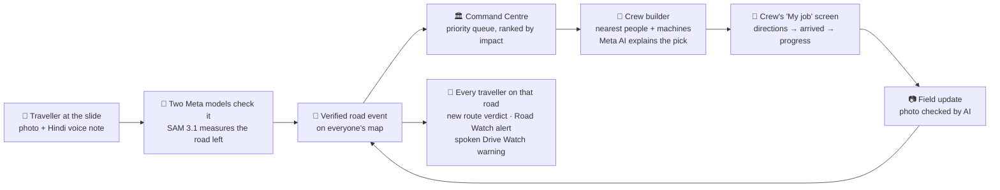

1. **The public at the site** takes a photo and adds an optional Hindi voice note — 5 seconds. Meta's **SAM 3.1** blurs faces and number plates and measures how much road is left. **Two different Meta models** check each other before it becomes a verified road event.
2. **The department's Command Centre** ⭐ sees it in a priority queue ranked by impact (vehicle-hours lost per day).
3. **The crew builder** ⭐ picks the nearest on-duty people and machines for what the site needs; **Meta AI** explains why that crew, in English and Hindi. One tap: *Approve & send*.
4. **The crew on site** ⭐ gets a *My job* screen: directions → *I've arrived* → progress photos and voice notes. AI checks each progress photo against the earlier ones ("debris down ~70% — consistent with what you entered").
5. **Every traveller on that road** gets it instantly: a new route verdict, a **Road Watch** alert on saved trips, a spoken warning in **Drive Watch**.
6. And around the slide: **Slope Sentinel** ⭐ warns about the hillside *before* it comes down, and **"Can my vehicle cross?"** ⭐ compares your vehicle with the gap that's left.

---

## 🆚 How it's different from Google Maps / Waze

| | Google Maps / Waze | **Pathfinder** |
|---|:---:|:---:|
| Route, distance, drive time | ✅ | ✅ (and hands off to Google Maps for turn-by-turn) |
| *Why* the road is slow or closed | ❌ | ✅ landslide / snow / damaged road / jam, with photos |
| Measured road left ("~2.9 m of 7 m open") | ❌ | ✅ SAM 3.1 + reference objects, as a range |
| Will **my** vehicle fit through? | ❌ | ✅ spec table + code maths + 2 AI models |
| Warning **before** a slide (cracks, seepage above the road) | ❌ | ✅ Slope Sentinel |
| When it will reopen | ❌ | ✅ debris volume → clearing time, crew progress |
| Live updates **from the road department and crews** | ❌ | ✅ field updates with photo + voice note |
| Department can **send a crew** from the same report | ❌ | ✅ Command Centre + crew builder |
| Official public advisories (English + Hindi) | ❌ | ✅ |
| Report by Hindi voice note | ❌ | ✅ Muse Voice Transcribe |
| Every report verified by **two different AI models** | ❌ | ✅ |
| Works on a day with zero incidents | ✅ | ✅ plain route + "All clear", no AI call |

**What Pathfinder doesn't do:** turn-by-turn voice navigation or live traffic speeds. For that, one tap on **Start** opens Pathfinder's chosen safe route in **Google Maps** (or Apple Maps), with waypoints that force the same road. *Pathfinder decides the safe route, Google Maps drives it.*

---

## ⭐ Features

### The standouts — things no maps app does

<table>
<tr>
<td width="33%" align="center">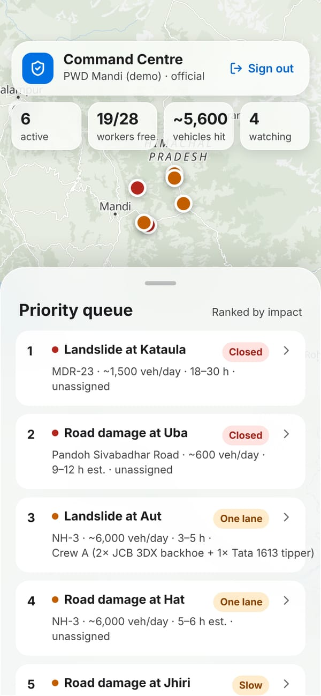<br/><b>Command Centre</b><br/><sub>For the district road office. Priority queue ranked by vehicle-hours lost, stat tiles, rain-risk layer, "Slopes to inspect".</sub></td>
<td width="33%" align="center">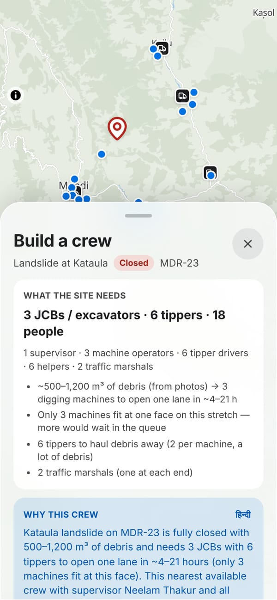<br/><b>Crew builder</b><br/><sub>What the site needs from the measured debris (machines, tippers, people) → nearest on-duty crew. Muse Spark Open explains the pick in EN/HI.</sub></td>
<td width="33%" align="center">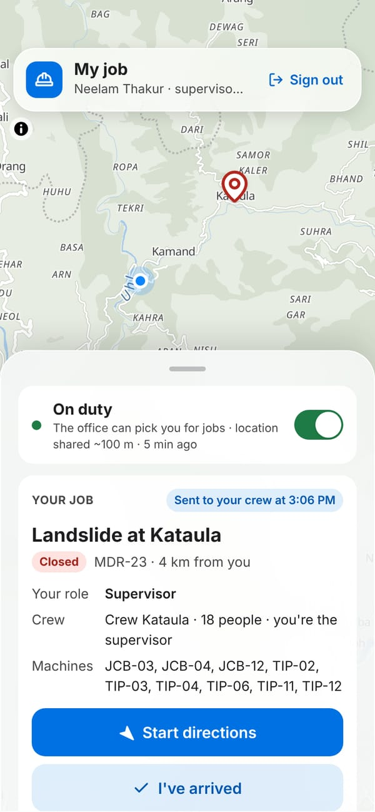<br/><b>Crew "My job"</b><br/><sub>For the supervisor on site: on-duty switch, the job, directions, "I've arrived", progress updates.</sub></td>
</tr>
<tr>
<td align="center">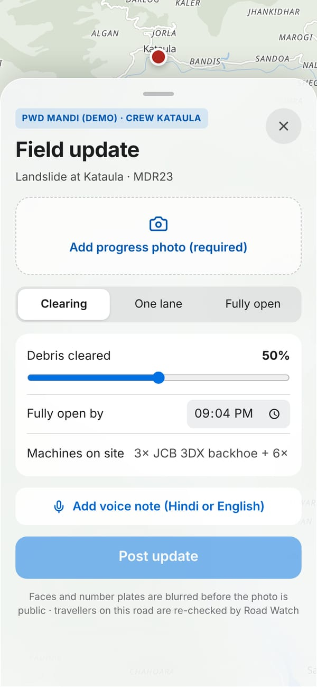<br/><b>Field update from the site</b><br/><sub>Progress photo (required) + % cleared + Hindi voice note. SAM checks the photo against the last one; mismatches are flagged, never hidden.</sub></td>
<td align="center">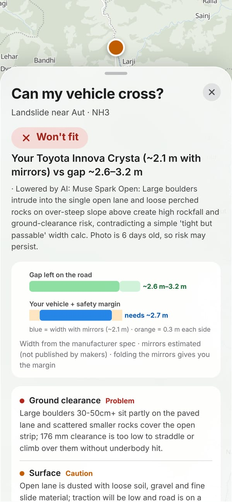<br/><b>Can my vehicle cross?</b><br/><sub>Vehicle width from a spec table, gap from SAM measurements, maths in code. Two models look at road + vehicle photos and can only make the verdict <i>stricter</i>.</sub></td>
<td align="center">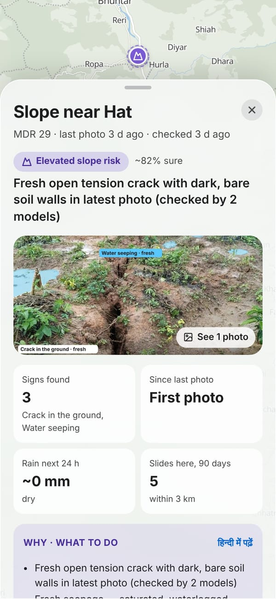<br/><b>Slope Sentinel</b><br/><sub>Photos of the hillside <i>above</i> the road, read like a field geologist (cracks, seepage, loose rock) × rain forecast × slide history → watch / elevated / high. Advice only — never closes a road.</sub></td>
</tr>
</table>

### For travellers

<table>
<tr>
<td width="33%" align="center">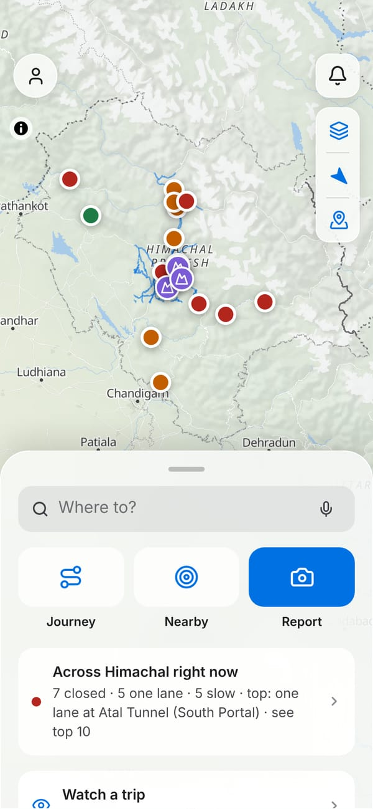<br/><b>Live map</b><br/><sub>Every verified event and slope site in Himachal; search any place in India.</sub></td>
<td width="33%" align="center">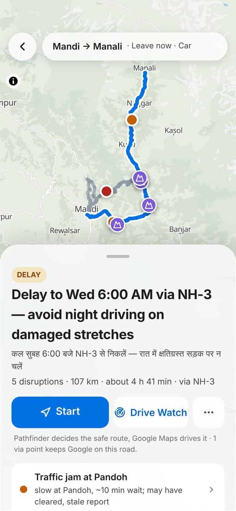<br/><b>Route Check agent</b><br/><sub>Muse Wonder + tools → "Leave Wed 6:00 AM via NH-3", every disrupted patch, What-If departure times, Start in Google Maps, Drive Watch.</sub></td>
<td width="33%" align="center">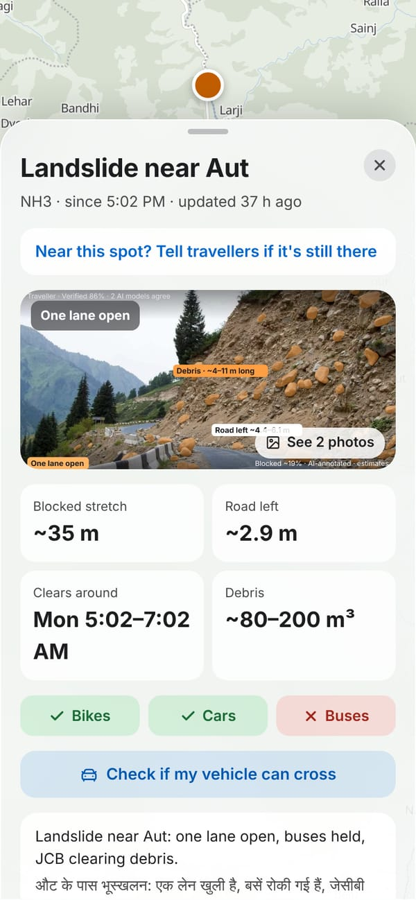<br/><b>Every disrupted patch, measured</b><br/><sub>Blocked stretch, road left, clears around, debris m³, bikes/cars/buses, "Verified 86% · 2 AI models agree".</sub></td>
</tr>
<tr>
<td align="center">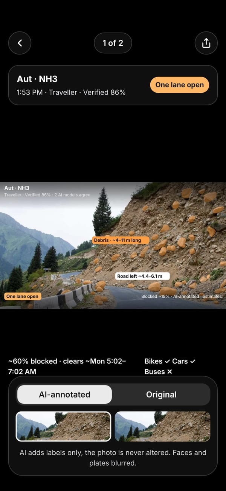<br/><b>AI-annotated evidence</b><br/><sub>Labels are drawn by code on a copy — the photo itself is never altered. Faces and plates blurred.</sub></td>
<td align="center">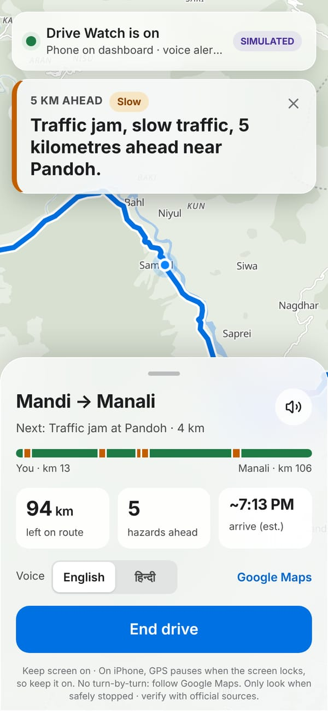<br/><b>Drive Watch</b><br/><sub>Runs next to Google Maps: speaks hazards 5 km and 1 km ahead in English or Hindi, live Road Watch changes, keeps the screen on.</sub></td>
<td align="center">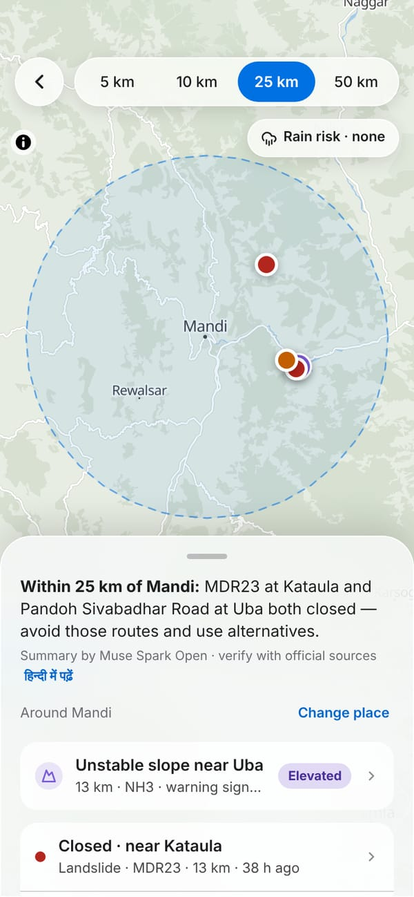<br/><b>Nearby</b><br/><sub>Everything within 5–50 km, ranked, with a one-line AI summary and a rain-risk layer.</sub></td>
</tr>
</table>

**Also built:**
- **📸 Report in 5 seconds** — photo + optional Hindi voice note; a voice note that mentions *other* places adds to those events too. *Not in India? Tap "Pick a spot" to drop a report on a demo road.*
- **🔔 Road Watch** — save a trip; when an event on your route changes, the agent re-plans and alerts you. Event-driven: no AI runs unless something actually changed.
- **🗺️ Trips from outside the state** — Delhi → Manali is split at the state border: normal drive outside, full checks inside.
- **🙋 "Still there?" taps** — people driving past answer in one tap; reports expire on their own when nobody confirms them.
- **🕵️ Investigator agent** — re-checks doubtful or stale events with a grounded news search; it can flag, never silently change a status.
- **📰 News ingest** — grounded web search finds new closures before anyone reports them (only articles ≤ 72 h old with URLs the search actually opened).
- **📣 Public advisories** — the office publishes an English + Hindi advisory that reaches everyone watching a trip through that spot.
- **🖼️ Share alert card** — Muse Image illustration + exact EN/HI text set by code, for WhatsApp.
- **🏅 Scouts** — opted-in people nearby (only when stopped, max 2 a day) get asked for a fresh photo where data is old; points and badges.
- **🌧️ Rain risk** — forecast × slide history, as a purple band along your route.

---

## 🤖 Which Meta model does what

| Meta model | Where it runs | Pathfinder jobs |
|---|---|---|
| **Muse Spark Open** (`meta-models/muse-spark-open-1026`, **open weights**) | Baseten | First choice for every text/vision job: writes the structured claim from a photo, reads slope photos, identifies vehicles and compares them with road photos, explains crew picks, Investigator agent, news parsing, Nearby summaries, advisory drafts, translates site voice notes. Fallback for every agent (tool calling works). |
| **Muse Spark 1.3** | Meta Model API | The **independent second model**: verifies every claim, slope reading and vehicle-fit assessment → "2 AI models agree". Grounded web search for news and the Investigator. Fixes Hindi that comes back in Latin script. |
| **Muse Wonder 1.0** | Meta Model API | Tool-calling agents: **Route Check / What-If**, **Road Watch** re-planning, **Slope risk**. |
| **SAM 3.1** | Meta Model API | Masks for road, landslide, rock, boulder, vehicle, excavator, snow, water, retaining wall, tree → **measurements** (blocked %, road left, debris, seepage) and **face / number-plate blurring**. |
| **Muse Voice Transcribe** | Meta Model API | Hindi / English voice notes from travellers and crews → clean Devanagari text. |
| **Muse Image** | Meta Model API | Illustration on the shareable alert card (all text set by code, never by the image model). |

**Two models, two providers, checking each other.** Every traveller report is written by Muse Spark Open (Baseten) and verified independently by Muse Spark 1.3 (Meta Model API). If they disagree, the checker can correct or reject it. Live stats are on [`/verification`](https://pathfinder1-ten.vercel.app/verification).

**Models propose, code decides.** Status changes, impact ranking, crew picks, clearing-time estimates, slope-risk caps and the vehicle verdict are computed in code; AI explains and can only make a verdict *stricter*. Every number is a range with "~" and a confidence.

**It never crashes because of an AI provider.** One router (`src/lib/ai/router.ts`) for every call: zod-validated JSON, retries with backoff, a circuit breaker on billing/auth errors, Baseten ⇄ Meta fallback, a daily spend cap, every call logged with tokens and cost — and a no-AI last resort for every job.

---

## 🛠️ How we built it

### Day by day (all inside the hackathon window)

| When | What got built |
|---|---|
| **Oct 27** | Next.js app, AI router with fallbacks, first calls to both providers; proved vision, SAM 3.1 and Hindi voice on real photos |
| **Oct 28** | Real Himachal road map (OpenStreetMap: 18,280 one-km road segments); report → two-model verification → annotated photo → event on the map; Route Check agent; Nearby, news ingest, Road Watch, rain risk; Command Centre; Investigator, Scouts, share cards |
| **Oct 30** | Start in Google Maps + Drive Watch (spoken EN/HI alerts) |
| **Oct 31** | Slope Sentinel, "Can my vehicle cross?", production hardening (rate limits, spend cap, cron security), real photos, PWA, deploy, live smoke test |
| **Nov 1** | Crew builder + crew "My job" accounts, district sign-in, live sync between office/crew/travellers, event lifecycle ("Still there?" taps, auto-expiry), concurrency fixes |
| **Nov 2–3** | Manual testing on phones and fixes (pick-a-spot reporting for testers outside India, Hindi quality, downloaded-photo detection) |

### Architecture

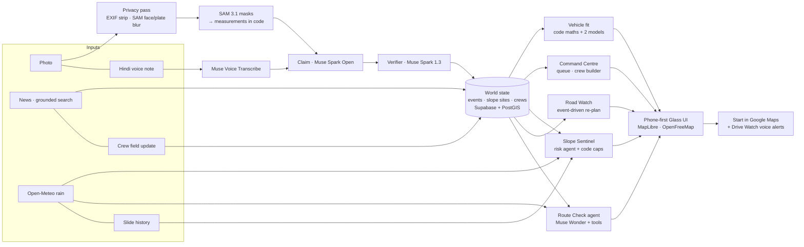

### Tech stack

Next.js 15 (App Router) + TypeScript on **Vercel** · **Supabase** (Postgres + PostGIS, Storage, Auth) · **MapLibre GL** + OpenFreeMap vector tiles · **OpenStreetMap** road layer (Overpass) · **OSRM** routing · **Photon** place search · **Open-Meteo** weather · **Turf.js** · **sharp** (privacy blur, annotations) · **zod** · OpenAI SDK pointed at the **Meta Model API** and **Baseten**. Phone-first "Glass" UI, installable as a PWA.

---

## 🧗 Hard problems we solved

- **Metres from pixels, honestly.** SAM's `debris` concept found nothing on real slides, so we combine `landslide`, `rock`, `boulder` and `road` masks and use cars and backhoes in the frame as a scale. No reference object → "unknown", never a made-up number.
- **Stale news.** Grounded search sometimes cites year-old articles as current. Code only accepts URLs the search actually opened, published in the last 72 hours.
- **Routing around a closure** when the public router can't avoid a point: we search nearby national highways for via-points that force a detour.
- **Keeping AI cost low.** No AI at all on clear routes; the cheaper model for simple routes; Muse Wonder only with several events or a closure; caches keyed on event versions. The whole build stayed far below the $150 credit, with every call's cost logged.
- **Live sync.** An office, a crew and hundreds of travellers editing the same event: optimistic locking on every event write, and a data-version signal so every screen updates within seconds.

---

## 🚀 Try it — a judge's path (5 minutes)

**Live app:** https://pathfinder1-ten.vercel.app — best on a phone, or a narrow browser window.

1. **Traveller:** search **Manali** → *Directions* → read the verdict → open a disruption → **Check if my vehicle can cross**. Tap **Drive Watch** and add `&simulate=1` to the URL to hear the spoken alerts without driving.
2. **Report** (works from anywhere): tap **Report** → when it says *Outside Himachal*, use **Pick a spot** to drop the report on a demo road → upload any road photo.
3. **District office:** go to `/official/login` → **PWD / district office** → choose **Mandi** → Department ID **`PWD-MANDI-DEMO`**, password **`himachal-demo`**. Scroll to the crew card → **Landslide at Kataula · Build crew** → **Approve & send**.
4. **On-site crew:** sign out → `/official/login` → **On-site crew member** → Crew ID **`CREW-MANDI-DEMO`**, password **`himachal-crew`** (Neelam Thakur, a supervisor near Kataula). The job you just sent is waiting under **My job**.
5. **Close the loop:** as Neelam, tap **I've arrived** → **Post progress update** → add any photo, choose **One lane**, 60% → **Post**. Now open **Mandi → Manali** as a traveller (another browser or a private window): Kataula shows *one lane*, with a **repair crew working** card and the crew's update on the event page.
6. **Slope Sentinel:** on the map, tap a purple ⛰ marker → warning signs read from the hillside photo, rain in the next 24 h, slides nearby, advice in English/Hindi. Add `?replay=1` to `/route` or `/nearby` to replay a real monsoon day's rain.
7. **Road Watch:** on a route, switch on **Watch this trip** → when an event on it changes (step 5 does this), the 🔔 on the home screen gets an alert with the new plan.

More to poke at: **Nearby** (radius 5–50 km + AI summary) · **Share alert card** on any event · [`/verification`](https://pathfinder1-ten.vercel.app/verification) (how often the two AI models agree) · **Me** (scout points and badges) · `/himachal` (top 10 problems across the state).

Demo accounts only change demo data (fictional people and machines); real travellers never see it.

---

## 💻 Run it locally

Node 22+ and pnpm. Scripts run with plain `node` (Node strips the TypeScript types).

```bash
pnpm install
cp .env.example .env.local   # fill in the keys — never commit them
pnpm dev                     # http://localhost:3000
```

Database: create a Supabase project, run `supabase/migrations/*.sql` in order in the SQL Editor, then load data:

```bash
pnpm load-segments     # 18,280 road segments + 14,677 places (OpenStreetMap)
pnpm demo-reset        # demo events, crews, workers, machines, both demo logins (all is_demo)
pnpm seed-slopes       # 2 demo slope sites via the real pipeline (~$0.15 of AI calls)
```

Tests without AI calls: `pnpm test:fit` · `test:slope` · `test:drive` · `test:guard` · `test:reopening` · `test:risk` · `test:lifecycle` · `test:crew-needs`. `AI_MODE=mock` runs everything on fixtures.

<details>
<summary><b>Environment variables</b> (names only live in <code>.env.example</code>)</summary>

| Variable | Required | What |
|---|---|---|
| `MODEL_API_KEY` | yes | Meta Model API: Muse Spark 1.3, Muse Wonder, Muse Image, Muse Voice Transcribe, SAM 3.1 |
| `BASETEN_API_KEY` | yes | Baseten: Muse Spark Open (open weights) |
| `NEXT_PUBLIC_SUPABASE_URL` | yes | `https://<ref>.supabase.co` |
| `NEXT_PUBLIC_SUPABASE_ANON_KEY` | yes | public by design; row-level security allows public reads only |
| `SUPABASE_SERVICE_ROLE_KEY` | yes | server-side writes; never prefix with `NEXT_PUBLIC_` |
| `CRON_SECRET` | yes (prod) | protects `/api/cron/*` |
| `AI_DAILY_CAP_USD` | no (10) | daily AI spend cap → no-AI fallbacks above it |
| `AI_MODE` | no (`auto`) | `mock` = fixtures only |
| `OSRM_URL`, `NEXT_PUBLIC_MAP_STYLE_URL` | no | routing server, map style |

</details>

<details>
<summary><b>Production safety</b></summary>

- **Rate limits** on every AI endpoint, per IP and per device, with a friendly "try again" message; a **daily spend cap** checked by every AI job.
- **Cron jobs** (daily, `vercel.json`) protected by `CRON_SECRET`: news ingest, Investigator re-check, scout gaps, Slope Sentinel, Road Watch sweep. Road Watch itself is event-driven.
- **Privacy:** EXIF stripped, faces and number plates blurred before anything is public, only ~1 km location for scouts and no location history; the original photo is never public.
- **Logs:** every AI call is a JSON line (purpose, provider, model, tokens, cost, latency, error) and a row in `ai_calls` — never keys, photos or voice notes. `pnpm scan-secrets` checks the working tree and full git history.

</details>

---

## 📜 License & credits

MIT — see [LICENSE](LICENSE). Map data © OpenStreetMap contributors · tiles by OpenFreeMap · weather by Open-Meteo · routing by OSRM · search by Photon. Road conditions shown are estimates from photos and reports — always follow police and PWD instructions on site.
