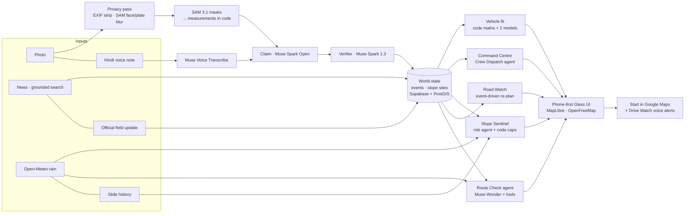

# Pathfinder — AI-verified road & trek conditions for Himachal Pradesh

> **Pathfinder decides the safe route, Google Maps drives it.**
> Pathfinder warns you before the hill comes down, not after.

**Live:** https://pathfinder1-ten.vercel.app · **Built during the Meta Global AI Developer Hackathon, Oct 27 – Nov 4, 2026** (Indie Developer track, solo) · MIT licence

Landslides, snow and tourist jams close Himachal's mountain roads every season, and people still find out from scattered WhatsApp forwards — or when they reach the blockage. Pathfinder turns one photo (plus an optional Hindi voice note) into a **verified, measured road event**, then lets agents plan trips around it, watch saved trips, warn drivers on the way and help road officials decide what to clear first.

It is an **agentic, multi-source verification and planning system**: photos are one evidence source among news, official field updates, weather, slide history and traveller voice notes. Two different Meta models check each other; plain code does the maths and decides what changes.

## What it does

| Mode | Who | What |
|---|---|---|
| 📸 **Report** | People at the spot | Photo / Hindi voice note → SAM 3.1 measures the blockage → Muse Spark Open writes the report → Muse Spark 1.3 independently verifies → a road event on the map with an AI-annotated photo (faces and plates blurred) |
| 🧭 **Journey** | Travellers A → B | Every disrupted patch on the route, an agent's verdict ("Leave 5:30 AM via NH-3"), What-If departure times, rain risk, **Start** in Google Maps with waypoints that force the safe road, **Drive Watch** that speaks hazards ahead (EN/हिन्दी), **Road Watch** alerts on saved trips |
| ⛰️ **Slope Sentinel** | Travellers + officials | Photos of the hillside *above* the road read like a field geologist (cracks, seepage, loose rock), tracked over time × rain forecast × slide history → a pre-failure risk level. Advice only — it never closes a road |
| 🚙 **Can my vehicle cross?** | Travellers at a damaged stretch | Your vehicle (photo or list) vs the measured gap: spec-table widths, code maths, two models compare the road photos with your car — they can only make the verdict stricter |
| 📍 **Nearby** | People at a place | Everything within 5–50 km, ranked, with a short summary and a rain-risk layer |
| 🏛️ **Command Centre** | PWD / BRO / district officials (invite-only) | Priority queue by vehicle-hours lost, Crew Dispatch agent, public advisories EN/HI, field updates checked against the photo, slopes to inspect |

## Meta models — who does what

| Model | Where | Pathfinder jobs |
|---|---|---|
| **Muse Spark Open** (`meta-models/muse-spark-open-1026`, open weights) | Baseten | First choice for every text/vision job: writes report claims, reads slope photos, identifies vehicles and compares them with road photos, Investigator agent, news parsing, Nearby summaries, advisory drafts; fallback for every agent (tool calling works) |
| **Muse Spark 1.3** | Meta Model API | The independent second model: verifies every claim, slope reading and vehicle-fit assessment ("2 AI models agree"); grounded web search for news ingest and the Investigator |
| **Muse Wonder 1.0** | Meta Model API | Agents with tools: Route Check / What-If, Road Watch re-planning, Crew Dispatch, Slope risk |
| **SAM 3.1** | Meta Model API | Masks for road, landslide, rock, boulder, vehicle, excavator, snow, water, retaining wall, tree → measurements (blocked %, road left, debris area, seepage) and face / number-plate blurring |
| **Muse Voice Transcribe** | Meta Model API | Hindi / English voice notes → text (clean Devanagari) |
| **Muse Image** | Meta Model API | Illustration for the shareable alert card (text and Hindi are set by code, never by the image model) |

Every call goes through one router (`src/lib/ai/router.ts`): zod-validated JSON, retries with backoff, a 10-minute circuit breaker on billing/auth errors, provider fallback, a daily spend cap, and a no-AI last resort for every job — a provider outage never crashes a page.

## Architecture



**Rules the code enforces:** every number is a range with "~"; models propose, code decides (status changes, risk caps, the vehicle verdict can only be lowered); evidence photos are never altered (annotations are a separate copy drawn by code); only coarse (~1 km) location for scouts, never while moving.

## Try it

- **Traveller:** open the live link → search "Manali" → Directions → Start / Drive Watch. Add `&simulate=1` to the `/drive` URL to replay the drive and hear the alerts; add `&replay=1` to `/route` or `/nearby` to replay a real monsoon day's rain.
- **Report:** tap Report → take or choose a road photo (or Slope for a hillside), optionally hold the mic for a Hindi note.
- **Officials (demo):** `/official/login` → **Try as PWD Mandi (demo)** (or Department ID `PWD-MANDI-DEMO`, password `himachal-demo`). The demo account only changes demo data.

## Run it locally

Requires Node 22+ and pnpm. Scripts run with plain `node` (Node strips TypeScript types).

```bash
pnpm install
cp .env.example .env.local   # fill in the keys (never commit them)
pnpm dev                     # http://localhost:3000
```

Database: create a Supabase project, run `supabase/migrations/0001…0003*.sql` in the SQL Editor (in order), then load data:

```bash
pnpm load-segments     # 18,280 road segments + 14,677 places from data/ (OpenStreetMap)
pnpm seed              # demo events, crews, scouts (all is_demo)
pnpm create-official   # the PWD Mandi (demo) account
pnpm seed-slopes       # 2 demo slope sites via the real pipeline (~$0.15 of AI calls)
```

Tests (no AI calls unless noted): `pnpm test:fit` · `pnpm test:slope` · `pnpm test:drive` · `pnpm test:guard` · `pnpm test:reopening` · `pnpm test:risk` · `pnpm test:time-check`; live AI runs: `pnpm test:claim`, `pnpm test:route-check`, `pnpm test:slope-live`, `pnpm test:fit-live`. `AI_MODE=mock` runs everything on fixtures.

## Stack

Next.js 15 (App Router) + TypeScript · Tailwind v4 · MapLibre GL + OpenFreeMap tiles · OpenStreetMap roads (Overpass) · Turf.js · OSRM routing · Photon search · Open-Meteo · Supabase (Postgres + PostGIS, Storage, Auth) · sharp · zod · OpenAI SDK pointed at the Meta Model API and Baseten · Vercel (crons, Fluid compute).

## Environment variables

Names only live in [`.env.example`](.env.example). Never commit values — the repo is public.

| Variable | Where | Required | What |
|---|---|---|---|
| `MODEL_API_KEY` | server | yes | Meta Model API: Muse Spark 1.3, Muse Wonder, Muse Image, Muse Voice Transcribe, SAM 3.1 |
| `BASETEN_API_KEY` | server | yes | Baseten: Muse Spark Open (open weights) |
| `NEXT_PUBLIC_SUPABASE_URL` | client + server | yes | `https://<ref>.supabase.co` |
| `NEXT_PUBLIC_SUPABASE_ANON_KEY` | client + server | yes | public by design; RLS allows public reads only |
| `SUPABASE_SERVICE_ROLE_KEY` | server | yes | all writes; never prefix with `NEXT_PUBLIC_` |
| `CRON_SECRET` | server | yes (prod) | protects `/api/cron/*`; without it production refuses every cron call |
| `AI_DAILY_CAP_USD` | server | no (10) | global AI spend cap per IST day → no-AI fallbacks above it |
| `AI_MODE` | server | no (`auto`) | `mock` = fixtures only, no AI calls |
| `OSRM_URL` | server | no | routing server (public OSRM demo by default) |
| `NEXT_PUBLIC_MAP_STYLE_URL` | client | no | OpenFreeMap style |

### Vercel checklist (Project → Settings → Environment Variables, Production + Preview)

1. `MODEL_API_KEY`, `BASETEN_API_KEY`, `SUPABASE_SERVICE_ROLE_KEY` — mark **Sensitive**.
2. `NEXT_PUBLIC_SUPABASE_URL`, `NEXT_PUBLIC_SUPABASE_ANON_KEY`.
3. `CRON_SECRET` — a new random value (e.g. `openssl rand -hex 32`), Sensitive.
4. Optional: `AI_DAILY_CAP_USD` (default 10).
5. Framework preset = Next.js; redeploy after changing variables.

## Production safety

- **Cron jobs** (`vercel.json`, all daily — Hobby allows 100 jobs, once a day, ±59 min): news ingest 01:30 UTC, Investigator re-verify 07:30, scout gaps 10:00, Slope Sentinel 11:30, Road Watch sweep 13:00. Road Watch itself is event-driven (runs right after a report / news item / field update); the daily sweep is a safety net. Each cron route checks `Authorization: Bearer $CRON_SECRET` (constant-time).
- **Rate limits** on every AI endpoint, per IP and per device (`src/lib/guard/rateLimit.ts`), with a friendly "try again in N minutes" message; **daily spend cap** (`src/lib/ai/budget.ts`) checked by every AI job — above it the app uses its no-AI fallbacks instead of failing.
- **Demo login for judges:** "Try as PWD Mandi (demo)" on `/official/login`. The demo account only changes demo data; its advisories reach demo devices and the judge's own phone, never real travellers. Reset everything it touched with `pnpm demo-reset`.
- **Logs:** every AI call is one JSON line in the Vercel logs (purpose, provider, model, tokens, cost, latency, error kind, HTTP status) and a row in `ai_calls` — never keys, photos or voice notes.
- **Secret scan:** `pnpm scan-secrets` (working tree + full git history).
